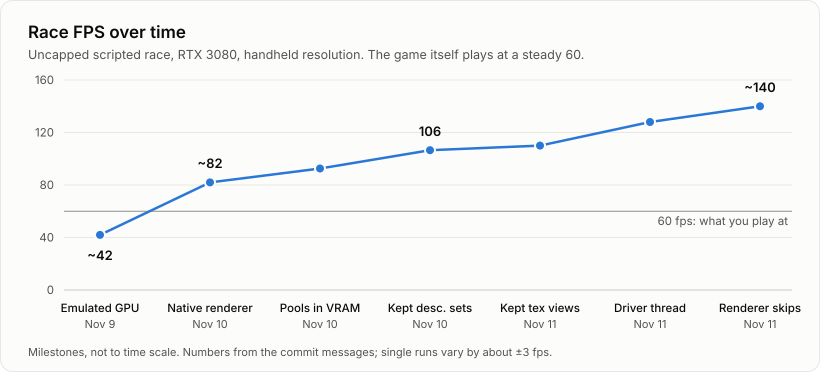

# kart-recomp

A native Windows port of the Switch 2 kart game. Its ARM64 code is recompiled ahead of time into
C++, and a small host stands in for the console, with the game's graphics running on Vulkan. No
emulated CPU or GPU. Versions 1.0.0 and 1.8.0 work.



> [!IMPORTANT]
> No game code or data is included. Don't use this with pirated copies: own the game and a
> Switch 2, and dump the game from your own console.

## Run it

You need Windows 10/11, a Vulkan 1.3 GPU, Python 3.13+ and the .NET 10 SDK. No Visual Studio: the
C++ compiler (LLVM MinGW) is downloaded on first use. The launcher installs the Python packages and
builds the rest; everything else is in the repository.

```
launcher\build.bat
launcher\out\launcher.exe
```

The launcher takes you from your dump (or `.nup`) to playing. The first build takes about
half an hour on an 8-core CPU, with a progress bar. Controls, settings and how it all works: [docs/how-it-works.md](docs/how-it-works.md).

## License

GPL-3.0-or-later. Third-party code and its licenses are listed in `third_party\README.md`.
